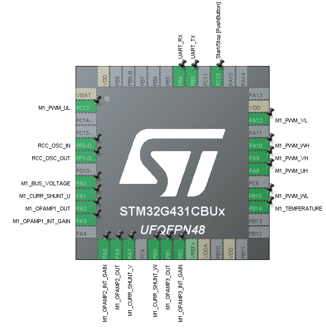

# BLDC-Control

6-step commutation of a BLDC motor on STM32 (B-G431B-ESC1).

## Goal
Learn how a BLDC motor is driven, from commutation principle to a working firmware, and verify it with measured waveforms.

## Hardware
- Board: STMicroelectronics B-G431B-ESC1
- Motor: RS2205-2300
- Tools: (사용한 측정 도구 기입)

## Progress
- [x] Repository created
- [ ] 6-step commutation (Hall sensor)
- [ ] Waveform capture
- [ ] Speed vs. duty cycle measurement

## Photos

